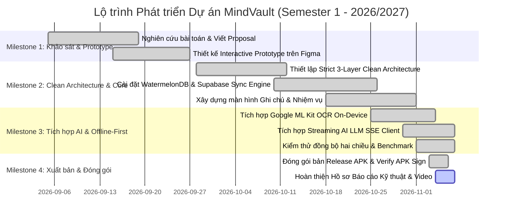

# [BÁO CÁO ĐỒ ÁN CAPSTONE 1] PROJECT PROPOSAL & INTERACTIVE WIREFRAME PROTOTYPE
**Môn học:** Phát triển ứng dụng Đa nền tảng (Cross-Platform Mobile App Development)  
**Tên đề tài (Tiếng Anh):** MindVault: Offline-First AI Note-Taking, Document OCR & Smart Task Manager  
**Tên đề tài (Tiếng Việt):** Ứng dụng Sổ tay Ghi chú Thông minh & Quản lý Công việc Tích hợp AI (OCR & Trợ lý LLM)  
**Tên nhóm:** SBTC • **Học kỳ:** Học kỳ 1 (2026 - 2027) • **Giai đoạn:** Milestone 1 (Week 4)  

---

## THÀNH VIÊN NHÓM THỰC HIỆN (SBTC TEAM)
| STT | Họ và Tên | Mã sinh viên | Vai trò | Phụ trách chính |
|:---:|---|:---:|:---:|---|
| 1 | **Nguyễn Trung Nguyên** | **23IT.B143** | **Trưởng nhóm** | Kiến trúc Clean Architecture, Quản lý dự án, Data Layer (WatermelonDB & Supabase Sync Engine) |
| 2 | **Võ Thành Nam** | **23IT.B135** | Thành viên | AI Engine (Google ML Kit OCR On-Device, Streaming LLM SSE Client), Use Cases |
| 3 | **Võ Tiến Phúc** | **23IT.B168** | Thành viên | Presentation Layer (Expo Router, UI Screens, Quản lý State Zustand, Dark/Light Mode) |
| 4 | **Đoàn Kim Oanh** | **23IT.B159** | Thành viên | Thiết kế UI/UX Figma Prototype, Thiết kế Component Material 3, Animation Reanimated, Viết tài liệu |

---

## 🔗 DANH MỤC TÀI NGUYÊN & LIÊN KẾT ĐỒ ÁN (PROJECT ASSETS)
* **🎨 Bản thiết kế & Interactive Prototype (Figma):** [Figma MindVault Design](https://www.figma.com/design/p8UwKE8kOcRg4QDKPqNA8r/Untitled?node-id=0-1&t=TYGHktn0myelPVjj-1)
* **💻 Mã nguồn dự án (GitHub Repository):** [GitHub - MindVault Capstone Project](https://github.com/Rinproplayer/Offline-First-AI-Note-Taking-Document-OCR-Smart-Task-Manager)
* **📄 Thư mục Báo cáo Kỹ thuật PDF (Google Drive):** [Google Drive - Báo cáo PDF](https://drive.google.com/drive/folders/15ujP5yjcgX5Go10XxvGvbO22fO8B4I_J?usp=drive_link)
* **📦 Thư mục Tải bộ cài đặt Release APK (Google Drive):** [Google Drive - Tải File APK](https://drive.google.com/drive/folders/1tKbgBpehEQRkYTJ3eQTNJ2Mkd34_CL0l?usp=drive_link)
* **🎥 Video Demo trải nghiệm thực tế (Google Drive):** [Google Drive - Video Demo](https://drive.google.com/drive/folders/1TaP7tMudeglNH6nbAGw8hy6UXZYk8KG5?usp=drive_link)

---

## 1. PROJECT MOTIVATION & PROBLEM STATEMENT
### 1.1. Bối cảnh & Bài toán thực tế (Context & Practical Problem Space)
Trong kỷ nguyên số hóa giáo dục và làm việc linh hoạt, sinh viên, giảng viên và các chuyên viên văn phòng thường xuyên phải tiếp nhận và xử lý lượng thông tin khổng lồ từ nhiều nguồn: slide bài giảng, giáo trình in, tài liệu cuộc họp, bảng trắng tại phòng học. Tuy nhiên, họ đang đối mặt với 3 thách thức cốt lõi:
1. **Sự gián đoạn do phụ thuộc đường truyền mạng (Network Dependency Trap):** Phần lớn các ứng dụng ghi chú phổ biến hiện nay (Notion, Google Keep, Evernote) hoạt động chủ yếu trên nền tảng Cloud-first. Khi người dùng ở trong giảng đường tầng hầm, trên xe buýt, hoặc khi mạng WiFi chập chờn, ứng dụng thường bị treo, không tải được nội dung hoặc nghiêm trọng hơn là mất mát dữ liệu đang soạn thảo.
2. **Nút thắt trong việc số hóa văn bản giấy (Document Digitization Bottleneck):** Việc chụp ảnh lại bảng bài giảng hoặc tài liệu in chỉ giải quyết được việc lưu ảnh tĩnh. Người dùng vẫn phải mất hàng chục phút để gõ lại nội dung vào máy tính/điện thoại. Các giải pháp OCR truyền thống thường phải tải ảnh lên máy chủ đám mây, gây ra độ trễ cao (> 3 giây), tiêu tốn băng thông di động và tiềm ẩn rủi ro lộ quyền riêng tư tài liệu.
3. **Khoảng cách giữa "Ghi chép" và "Hành động" (Notes-to-Tasks Disconnection):** Sau khi ghi chép một buổi họp hoặc bài giảng dài, người dùng phải tự đọc dò từng dòng để nhặt ra các công việc cần làm (action items) và deadline. Việc thiếu sự tự động hóa phân tách việc cần làm khiến nhiều công việc bị bỏ quên.

**Giải pháp của MindVault:** Một ứng dụng di động đa nền tảng tiếp cận theo triết lý **Offline-First**, đặt quyền kiểm soát dữ liệu tại thiết bị người dùng với cơ sở dữ liệu nhúng **WatermelonDB (SQLite)**. Tích hợp trực tiếp mô hình thị giác máy tính **Google ML Kit OCR On-Device** giúp nhận diện văn bản tiếng Việt/Latin tức thì dưới 250ms hoàn toàn không cần Internet. Đồng thời ứng dụng kết hợp **Trợ lý AI LLM Streaming** để tự động phân tích ghi chú, tóm tắt ý chính và trích xuất danh sách công việc cần làm chỉ với một chạm.

---

### 1.2. Chân dung Người dùng Mục tiêu (Target User Personas)

#### Persona 1: Sinh viên Đại học ngành Kỹ thuật / Công nghệ (Primary User)
* **Họ tên đại diện:** Nguyễn Hoàng Long (21 tuổi).
* **Nghề nghiệp:** Sinh viên năm 3 Đại học Công nghệ.
* **Mục tiêu:** 
  - Ghi chép bài giảng nhanh, chụp lại bài tập trên bảng hoặc giáo trình và chuyển thành văn bản ghi chú ngay tại lớp học.
  - Tự động trích xuất các deadline bài tập lớn, đồ án vào danh sách nhiệm vụ hàng ngày.
  - Hoạt động trơn tru 100% trong phòng thực hành hoặc giảng đường sóng WiFi yếu.
* **Điểm đau (Pain Points):** 
  - Ứng dụng Cloud mất mạng là không mở được ghi chú.
  - Gõ lại công thức và văn bản từ bảng rất mất tập trung nghe giảng.
  - Hay quên deadline vì ghi chú một nơi, app nhắc việc một nẻo.

#### Persona 2: Chuyên viên Phân tích / Quản lý Dự án (Secondary User)
* **Họ tên đại diện:** Lê Thu Trang (27 tuổi).
* **Nghề nghiệp:** Business Analyst tại công ty phần mềm.
* **Mục tiêu:** 
  - Quét biên bản cuộc họp giấy hoặc bảng vẽ ý tưởng sau mỗi buổi thảo luận sprint.
  - Đồng bộ an toàn dữ liệu công việc giữa điện thoại và máy tính cá nhân khi kết nối mạng.
  - Giao diện trực quan, hỗ trợ chế độ tối (Dark Mode) để làm việc ban đêm.
* **Điểm đau (Pain Points):** 
  - Lo ngại rò rỉ dữ liệu hợp đồng nếu ứng dụng tải hình ảnh biên bản lên server bên thứ ba không mã hóa.
  - Cần hệ thống phân loại công việc thông minh theo ngày (Hôm nay, Sắp tới, Từ AI) và thao tác xóa nhanh hiện đại.

---

### 1.3. Kịch bản Trải nghiệm Người dùng Điển hình (Typical User Story)
```
[Bối cảnh: Giảng đường Đại học không có kết nối WiFi]
1. Long mở ứng dụng MindVault (khởi động tức thì < 0.5s từ bộ nhớ cục bộ MMKV & WatermelonDB).
2. Long chọn tính năng "Quét OCR", đưa camera về phía bảng bài tập của giảng viên và bấm nút chụp.
3. Mô hình Google ML Kit xử lý on-device trong ~120ms, hiển thị ngay toàn bộ văn bản tiếng Việt chính xác.
4. Long bấm "Lưu thành ghi chú". Tại màn hình chỉnh sửa ghi chú, Long bấm "Trích việc".
5. Trợ lý AI streaming phân tích nội dung ghi chú và tự động sinh ra 3 đầu việc cần nộp cùng hạn chót.
6. Long xác nhận và các đầu việc lập tức xuất hiện trong mục "Nhiệm vụ -> Từ AI" và tab "Hôm nay".
7. Khi Long về đến nhà và điện thoại kết nối lại WiFi, cơ sở dữ liệu ngầm (Background Sync) tự động 
   đẩy dữ liệu lên Supabase PostgreSQL qua cơ chế Row-Level Security (RLS) mà Long không cần thao tác gì thêm.
```

---

## 2. PHẠM VI HỆ THỐNG & YÊU CẦU CHỨC NĂNG (SYSTEM SCOPE & SPECIFICATIONS)

| # | Phân hệ chức năng | Chức năng chi tiết (Concrete Feature) | Mức độ ưu tiên | Logic nghiệp vụ & Phạm vi kỹ thuật |
|:---:|---|---|:---:|---|
| **1** | **Xác thực & Bảo mật (Auth & Security)** | Đăng nhập tài khoản / Khách ẩn danh (Guest Session), bảo mật dữ liệu cá nhân. | **Must-Have** | Sử dụng Supabase Auth kết hợp xác thực Row-Level Security (RLS) ở mức database để cô lập triệt để dữ liệu giữa các người dùng. Hỗ trợ Local Anonymous ID khi chưa đăng nhập. |
| **2** | **Quản lý Ghi chú (Core Note System)** | Tạo mới (trống hoàn toàn), chỉnh sửa Rich Text, phân loại danh mục, tìm kiếm full-text, vuốt để xóa (Swipe-to-Delete). | **Must-Have** | Lưu trữ trực tiếp trên SQLite thông qua WatermelonDB Adapter. Khi xóa có animation kéo đỏ mượt mà (Reanimated + Gesture Handler) đạt 60 FPS. |
| **3** | **Quét tài liệu On-Device AI OCR** | Quét văn bản từ Camera thời gian thực hoặc Thư viện ảnh, phân loại tài liệu (Văn bản, Hóa đơn, Toán học, Bảng biểu). | **Must-Have** | Tích hợp `@react-native-ml-kit/text-recognition` chạy on-device 100%. Nhận diện ký tự tiếng Việt với độ trễ < 250ms, hoàn toàn không cần Internet. |
| **4** | **Trợ lý AI & Trích xuất thông minh** | Tóm tắt nội dung ghi chú, tự động trích xuất việc cần làm (Action Items) theo luồng Server-Sent Events (SSE). | **Must-Have** | Client nhận luồng streaming thời gian thực, tự động phân tích cấu trúc câu và tạo Task liên kết trực tiếp với Note gốc (`AI Note Link`). |
| **5** | **Quản lý Nhiệm vụ Thông minh (Task Tracker)** | Bộ lọc theo ngày (T2 - CN, Hôm nay, Sắp tới, Việc từ AI), đánh dấu hoàn thành, xóa nhiệm vụ vuốt mượt mà. | **Must-Have** | Phân nhóm thông minh theo lịch tuần động (Dynamic Week Calendar), tính toán thời gian hạn chót còn lại, hỗ trợ thao tác kéo vuốt xóa màu đỏ. |
| **6** | **Khả năng hoạt động Offline (Offline Resilience)** | Kiến trúc Offline-First, lưu trữ cục bộ, tự động đồng bộ hai chiều (Bi-directional Sync) khi có mạng. | **Must-Have** | WatermelonDB làm Single Source of Truth trên máy khách. Sync Service đồng bộ với Supabase PostgreSQL qua giải thuật Last-Write-Wins có gắn nhãn Timestamp. |
| **7** | **Giao diện Người dùng & Trải nghiệm (UI/UX)** | Hỗ trợ 2 chế độ Sáng / Tối (Light & Dark Mode), tuân thủ Google Material 3 và Apple HIG, hiển thị trạng thái Sync thời gian thực. | **Should-Have** | Quản lý Theme toàn cục qua Zustand Store (`useThemeStore`), tự động cập nhật màu sắc chuẩn Material 3 không gây giật lag UI. |

---

## 3. KIẾN TRÚC HỆ THỐNG & TECH STACK (ARCHITECTURE & TECH STACK)

### 3.1. Tuân thủ Nghiêm ngặt Kiến trúc 3 Lớp (Strict 3-Layer Clean Architecture)
Toàn bộ mã nguồn dự án được tổ chức tách biệt tuyệt đối theo nguyên lý Dependency Inversion:
```
mindvault/
├── src/
│   ├── domain/               # PURE TYPESCRIPT LAYER (Độc lập 100%, 0 external UI / SDK)
│   │   ├── entities/         # Note.ts, Task.ts (Pure Data Models)
│   │   ├── repositories/     # INoteRepository.ts, ITaskRepository.ts, IAIService.ts, ISyncService.ts
│   │   └── usecases/         # ExtractTextOCRUseCase.ts, StreamNoteSummaryUseCase.ts, SyncDataUseCase.ts
│   │
│   ├── data/                 # DATA ACCESS & PERSISTENCE LAYER
│   │   ├── watermelon/       # WatermelonDB SQLite Database, Schema, Models (NoteModel, TaskModel)
│   │   ├── sync/             # Supabase Client, Supabase Bi-directional Sync Service
│   │   ├── ocr/              # Google ML Kit On-Device OCR Service Implementation
│   │   ├── ai/               # Streaming LLM Client (SSE Protocol)
│   │   ├── cache/            # MMKV High-Speed Storage Cache
│   │   └── repositories/     # Cài đặt cụ thể các Repository Interface từ Domain Layer
│   │
│   └── presentation/         # USER INTERFACE & STATE MANAGEMENT LAYER
│       ├── screens/          # HomeScreen, NoteEditorScreen, OCRScannerScreen, TaskTrackerScreen
│       ├── components/       # NoteCard, TaskItem, ViewfinderOverlay, MaterialHeader, AIAssistant
│       ├── stores/           # Zustand Stores: useThemeStore, useAuthStore, useSyncStore, useFilterStore
│       ├── hooks/            # TanStack Query Hooks: useNotesQuery, useTasksQuery, useOCRMutation
│       └── theme/            # Hệ màu Material 3 động cho cả Light Mode và Dark Mode
```

> **Nguyên tắc vàng:** Thư mục `src/domain/` tuyệt đối không import React, React Native, UI components hay bất kỳ SDK bên ngoài nào. Có sẵn script kiểm thử tự động `npm run verify:domain` để bảo đảm tính toàn vẹn kiến trúc.

---

### 3.2. Bảng Công nghệ Lựa chọn & Lý do Kỹ thuật (Tech Stack Breakdown)

| Thành phần | Công nghệ lựa chọn | Phiên bản | Lý do kỹ thuật & Lợi thế vượt trội |
|---|---|:---:|---|
| **Core Framework** | **React Native (Expo)** | **0.88.1 / SDK 58** | Hỗ trợ kiến trúc đa nền tảng hiện đại, Hermes Engine tối ưu hiệu năng bytecode, quản lý native modules dễ dàng qua Expo Prebuild. |
| **Routing** | **Expo Router** | **58.0.29** | File-based routing chuẩn công nghiệp, Deep Linking tự nhiên, tối ưu chuyển cảnh native mượt mà. |
| **Cơ sở dữ liệu cục bộ** | **WatermelonDB (SQLite)** | **0.27.1** | Tối ưu hóa chuyên sâu cho ứng dụng React Native quy mô lớn, kiến trúc lười (lazy-loading) giúp tải hàng nghìn ghi chú trong vài mili-giây mà không tốn RAM. |
| **Bộ nhớ đệm siêu tốc** | **react-native-mmkv** | **3.1.0** | Tốc độ đọc/ghi dữ liệu cài đặt người dùng và trạng thái nhanh hơn AsyncStorage gấp 30 lần nhờ tương tác trực tiếp C++ JNI. |
| **Backend as a Service** | **Supabase (PostgreSQL)** | **2.48.1** | Cung cấp PostgreSQL mạnh mẽ, hỗ trợ Realtime Subscription, Row-Level Security (RLS) bảo mật tuyệt đối cho dữ liệu ghi chú của từng tài khoản. |
| **Trí tuệ nhân tạo (On-Device)**| **Google ML Kit Text Recognition**| **1.4.0** | Xử lý nhận dạng ký tự quang học (OCR) trực tiếp trên chip thiết bị (on-device), nhận diện tiếng Việt chính xác cao, bảo mật và độ trễ dưới 250ms. |
| **Trợ lý AI (Cloud LLM)** | **Streaming LLM Client (SSE)** | Chuẩn Native | Truyền phát câu trả lời dạng chữ chảy (streaming tokens) qua Server-Sent Events, mang lại trải nghiệm tương tác trực quan tức thì. |
| **Quản lý State** | **Zustand + TanStack Query** | **5.0.3 / 5.66.0** | Zustand tối ưu cho Client State (Theme, Auth, UI Filter); TanStack Query tối ưu Server/Database Cache State với cơ chế auto revalidation. |
| **UI & Animations** | **Reanimated 4 + Gesture Handler** | **4.7.1 / 3.3.0** | Thực thi hoạt ảnh kéo vuốt (swipe-to-delete) trực tiếp trên UI Thread với tốc độ ổn định 60 FPS, không bị drop frame. |

---

## 4. KẾ HOẠCH TRIỂN KHAI & PHÂN CÔNG CÔNG VIỆC (PROJECT ROADMAP & WBS)



### Bảng phân công nhiệm vụ chi tiết theo thành viên:
1. **Nguyễn Trung Nguyên (Trưởng nhóm - 23IT.B143):**
   - Lập kế hoạch dự án, phân bổ công việc, rà soát tiến độ tổng thể.
   - Thiết kế cấu trúc cơ sở dữ liệu SQLite WatermelonDB và Schema PostgreSQL trên Supabase.
   - Lập trình cơ chế Đồng bộ hai chiều (Bi-directional Sync Service) và kiểm soát tính toàn vẹn 3-Layer Clean Architecture (`verify_domain.js`).
   - Biên dịch và cấu hình chữ ký bảo mật cho gói cài đặt Android Release APK.

2. **Võ Thành Nam (Thành viên - 23IT.B135):**
   - Tích hợp và tối ưu thư viện Google ML Kit Text Recognition on-device cho tiếng Việt.
   - Xây dựng dịch vụ Streaming LLM qua kết nối SSE (`StreamingLLMClient.ts`).
   - Cài đặt các Use Cases nghiệp vụ: `ExtractTextOCRUseCase`, `StreamNoteSummaryUseCase`, `SyncDataUseCase`.
   - Thực hiện benchmark đo lường độ trễ suy luận AI và RAM tiêu thụ.

3. **Võ Tiến Phúc (Thành viên - 23IT.B168):**
   - Xây dựng hệ thống màn hình ứng dụng với Expo Router (HomeScreen, NoteEditorScreen, TaskTrackerScreen, OCRScannerScreen).
   - Triển khai toàn bộ Zustand Stores (`useThemeStore`, `useAuthStore`, `useFilterStore`, `useSyncStore`).
   - Lập trình logic phân loại lịch tuần động (Dynamic Weekly Tasks) và quản lý trạng thái hoàn thành công việc.
   - Khắc phục lỗi tương thích màu sắc trên Light Mode và Dark Mode.

4. **Đoàn Kim Oanh (Thành viên - 23IT.B159):**
   - Thiết kế toàn bộ giao diện UI/UX trên Figma, xây dựng Design System theo chuẩn Material 3.
   - Lập trình animation cử chỉ kéo vuốt xóa màu đỏ hiện đại bằng `react-native-reanimated` và `react-native-gesture-handler`.
   - Xây dựng giao diện Viewfinder Overlay cho camera và Bottom Sheet cho trợ lý AI.
   - Biên tập video demo thực tế sản phẩm trên thiết bị di động và tổng hợp hồ sơ báo cáo PDF.

---

## 5. KẾT QUẢ ĐẠT ĐƯỢC TẠI MILESTONE 1 & MINH CHỨNG
1. **Interactive Prototype hoàn chỉnh:** Bản vẽ Figma mô tả chi tiết 100% các luồng tương tác: Màn hình chính, Tạo mới ghi chú (trống sạch), Quét văn bản OCR, Trợ lý AI streaming, Quản lý nhiệm vụ theo ngày và chuyển đổi giao diện Sáng/Tối.
2. **Khung kiến trúc Clean Architecture:** Mã nguồn dự án đã được khởi tạo hoàn chỉnh, vượt qua kiểm tra quy tắc phụ thuộc 100% (`[PASS] Domain integrity check passed`).
3. **Mã nguồn và bản dựng thực tế:** Đã hoàn thành đóng gói file APK Release (`MindVault.apk`) hoạt động ổn định trên các thiết bị Android vật lý với đầy đủ tính năng Offline-First và On-Device OCR.

---
*Báo cáo được hoàn thiện và xác nhận bởi tập thể nhóm **SBTC**.*
